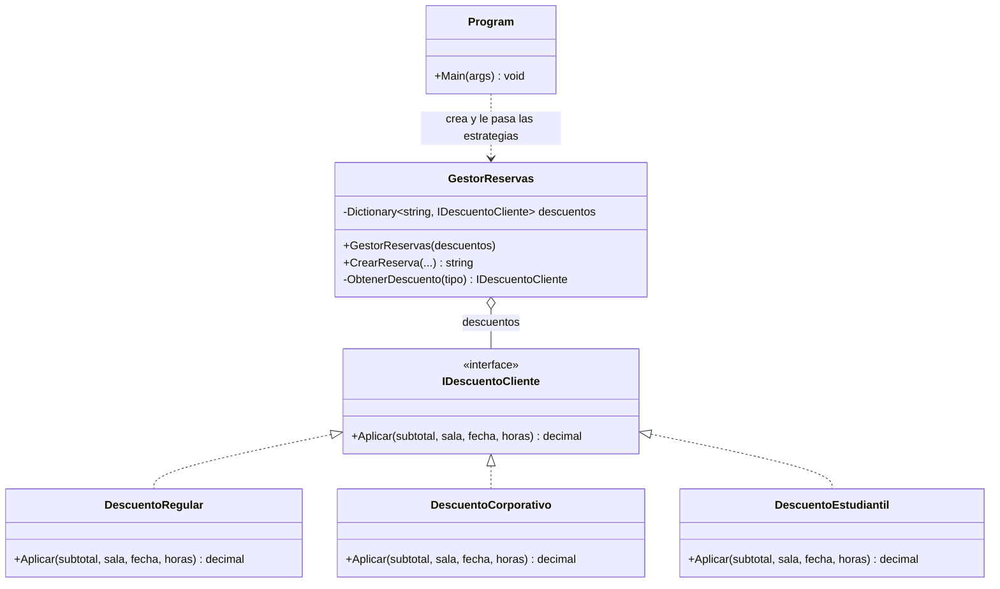

# Diagrama de clases: Strategy para el descuento por tipo de cliente

- **GestorReservas** es el contexto: guarda las estrategias (agregación, rombo) y usa la interfaz sin preguntar el tipo de cliente con `if`.
- **IDescuentoCliente** es la interfaz de la estrategia.
- **DescuentoRegular**, **DescuentoCorporativo** y **DescuentoEstudiantil** son las estrategias concretas (realización, triángulo con línea punteada).
- **Program** arma las estrategias y se las pasa a GestorReservas.

